# Market risk: volatility forecasting, VaR/ES and a Basel traffic light


A conditional-volatility study over 5,217 trading days of S&P 500 history (2005-01-03 to 2024-12-31), in which 11 volatility models are estimated walk-forward and their forecasts are turned into Value-at-Risk and Expected Shortfall by 7 different routes. Every route is then subjected to the four tests a risk function is actually audited on - Kupiec, Christoffersen, Engle-Manganelli and Acerbi-Szekely - and the result is mapped onto the Basel traffic light at the level the regulation is written for.

The organising question is not "which model is best" - that is a leaderboard, and leaderboards are easy. It is **which modelling choices survive being tested**, and how loudly each one fails when it does not. The answers are not all comfortable for the standard toolkit, which is why the backtesting half of this repository is longer than the forecasting half.

## Headline results

- The realised measure is well forecast, but not by the model with the most parameters. `harx` leads on QLIKE at **0.1251**, against 0.2461 for the 21-day trailing-variance baseline and 0.2922 for `rolling_63`.
- **3 of 7** VaR routes pass Kupiec at 99%, one-day. Every one of them is rejected in the *same* direction: the mildest, `fhs_gjr`, breaches 59 times against about 42 expected, and `parametric_normal_gjr` breaches 72. Risk is understated at this level, systematically, and nobody is being over-charged for it.
- At **fhs_evt_gjr** the simulated 10-day VaR deviates from the square-root-of-time rule by a mean of **3.02%**, and the rule understates the simulated risk on **77.8%** of days.
- The Basel traffic light puts **6 of 7** routes in green on the final 250-day window, but **14.3%** of *all* rolling windows are outside it, with a worst window of **7** exceptions. A single end-of-sample zone label is not a statement about the model.
- Expected Shortfall fails **none** of the 7 routes at 99%, and that is a weaker statement than it sounds: with 63 breach days on average the test cannot resolve anything smaller than a factor of about 3.5 on the tail. The mean excess column points the other way for most routes, and no p-value here is sharp enough to settle it.

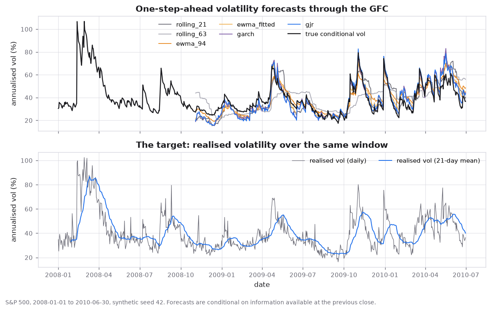

*Forecast paths against the realised measure. The shaded bands are the crisis windows the simulator was given; the model has never seen them.*

## The problem

A bank's market-risk number is not a prediction, it is a **quantile**. It is quoted, it is compared with the day's loss, it is counted against a regulatory threshold, and it determines how much capital has to be held against a trading book. That changes what "good" means. A forecast that is right on average and wrong exactly when it matters is not a mediocre forecast, it is a useless one, because the days it gets wrong are the days the number is used.

Three questions follow, and this repository answers all three with the same data:

1. **Does adding structure to the volatility model help?** A trailing variance is free, always available and hard to beat. Eleven models - from that baseline up through GARCH, a leverage term, a log-variance form, a heterogeneous-autoregression on realised measures, a gradient-boosted tree and a hand-written GRU - are estimated on the same expanding windows and scored on the same days.
2. **Does the route from a volatility forecast to a quantile matter?** Two historical routes, two filtrations of the same filter (one of them with a generalised-Pareto tail), two parametric forms and one simulation produce 7 different VaR numbers from one variance forecast. At 99% and one day they span 235 to 346 basis points - a factor of 1.47 on the same nominal coverage - and the disagreement is systematic rather than noise.
3. **Which ones survive the tests?** A model is admitted to the comparison only if it beats the baseline; a VaR route is called *passing* only if it clears all four coverage tests, not one. The word *adequate* is reserved for the separate Expected-Shortfall verdict, which asks a different question - not whether the breaches are the right number, but whether the losses beyond them are the right size. The failures are reported with the same prominence as the successes, because a risk study that reports only what worked is a marketing document.

## The data

The study runs on a **simulated** market by default: 5,217 trading days, 2005-01-03 to 2024-12-31, generated with seed **42**. Annualised realised volatility over the sample is **21.16%**.

Simulation is a deliberate choice, for three reasons that a real price file cannot provide:

- **The latent variance is known.** Whether a model is good or merely lucky can only be settled by scoring it against the variance that actually generated the returns. On real data that object does not exist, and every study is reduced to arguing about a noisy proxy.
- **The crisis windows are known.** A simulator can be told to put a 26-fold volatility event in February 2020; a historical sample contains whatever it contains. Stress behaviour can then be measured on a designed experiment instead of on whichever episode happened to be in the window.
- **The sample cannot be quietly tuned.** The parameters are fixed in `config.py`, the seed is recorded in `outputs/generator_manifest.json`, and the whole run is reproducible from both.

The generator is not a toy: one short-memory component, one near-unit-root long-memory component, a leverage term, Student-t innovations, compound-Poisson jumps shared across assets, and an intraday Brownian bridge so that realised variance, bipower variation and the jump test are computable rather than assumed. It also builds in a variance risk premium, which is why the realised measure sits systematically *above* the conditional variance - the feature that makes the latent-variance comparison in the results section meaningful rather than trivially favourable.

`--data-mode real` downloads index history through `yfinance` and runs the identical pipeline on it. Every number in this document comes from the synthetic run, because only the synthetic run supports the latent-variance scoring and the designed stress windows.

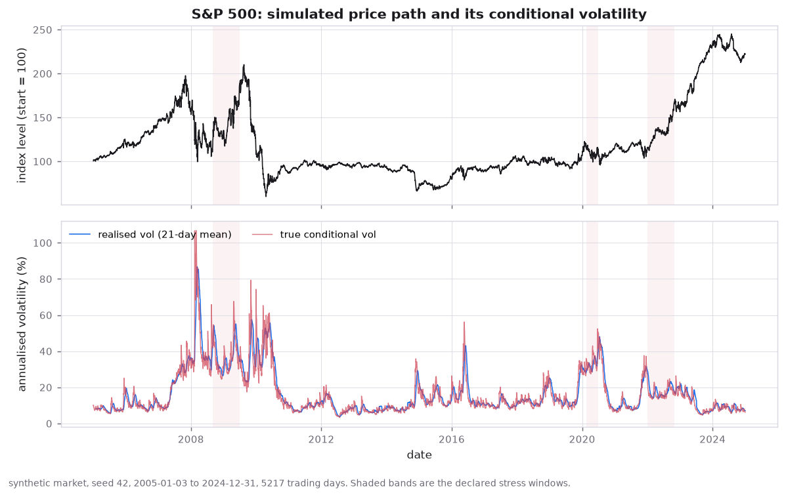

*Price, return and variance history for the simulated panel, with the crisis schedule shaded.*

## Method

### 1. Realised measures

Intraday returns at **78 bars a day** (a five-minute grid) are aggregated into realised variance, bipower variation, the jump variation and the Huang-Tauchen jump statistic, then into the HAR components: daily, weekly (5-day) and monthly (22-day) averages of log realised variance, plus a signed-return term and the leverage effect. The variance risk premium is **1.25**, so the realised measure is an upward-biased proxy for the quantity the models are estimating - which is precisely the bias the latent comparison is there to remove.

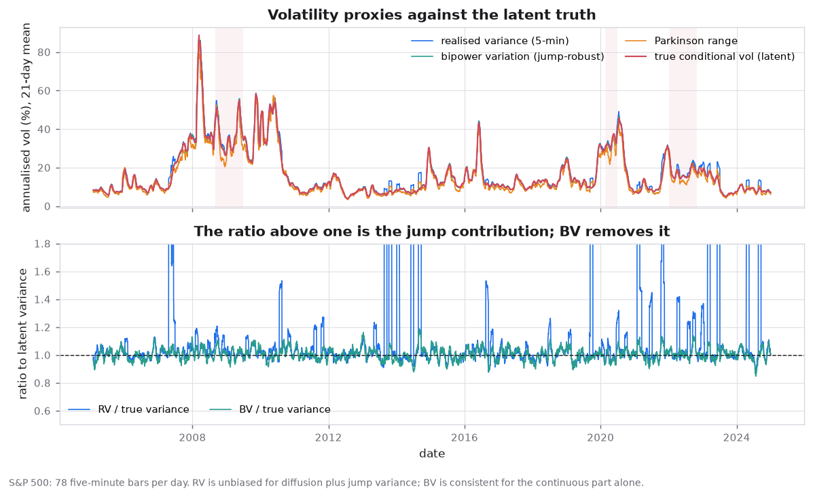

*Realised variance, its bipower and jump decompositions, and the jump statistic against the jumps the simulator placed.*

### 2. Volatility models

11 models are estimated on expanding windows with **monthly refits**, each asked for one-step-ahead variance forecasts over the following block. The variance *state* is filtered with realised returns inside the block while the parameters stay fixed, which is both what a desk does and the only way the recursions remain legal.

| model | what it adds over the one before |
|---|---|
| `rolling_21` | nothing. The trailing 21-day variance - the benchmark to beat |
| `rolling_63` | the same over a quarter |
| `ewma_94` | RiskMetrics decay, 0.94. Free, and the industry default |
| `ewma_fitted` | the same family, decay chosen on the training block |
| `garch` | a fitted mean-reverting recursion |
| `gjr` | asymmetry: negative shocks raise variance more |
| `egarch` | the recursion in logs, so no non-negativity constraint is needed |
| `har` | realised measures at three horizons rather than returns alone |
| `harx` | the same, plus the option-implied variance |
| `gbm` | a gradient-boosted tree on the same feature set |
| `gru` | a hand-written GRU, forward and backward pass, no framework |

### 3. From a variance forecast to a quantile

7 routes, all reading the same GJR-GARCH-t filter, so the differences below are differences of *method* and not of input:

| route | family | construction |
|---|---|---|
| `hs_250` | historical | empirical quantile of the last 250 raw returns |
| `hs_brw` | historical | the same, exponentially age-weighted (Boudoukh-Richardson-Whitelaw) |
| `fhs_gjr` | filtered | scale the filter by the empirical quantile of its standardised residuals |
| `fhs_evt_gjr` | filtered | the same, with the residual tail fitted by a generalised Pareto |
| `parametric_normal_gjr` | parametric | Gaussian quantile times the conditional volatility |
| `parametric_t_gjr` | parametric | Student-t quantile, tail index fitted by maximum likelihood |
| `monte_carlo` | simulation | simulate the variance recursion forward and read the quantile off the paths |

The horizon enters through the square-root-of-time rule for the parametric routes and through the simulation for the Monte-Carlo route, so the ten-day numbers are not a rescaling of the one-day numbers for every method - which is exactly what the scaling section measures.

### 4. Backtests

| test | question | fails when |
|---|---|---|
| Kupiec | is the breach rate right? | the rate is wrong in either direction - a model with no breaches is mispriced, not conservative |
| Christoffersen | are breaches independent? | they arrive in clusters, which the average cannot see |
| Conditional coverage | both, jointly | either one fails, weighted |
| Engle-Manganelli | is the breach predictable? | its own lags or the VaR level forecast it; strictly stronger than the two above |
| Acerbi-Szekely | is the ES the right size? | the average breach exceeds the ES - the failure that coverage cannot see |

At horizons above one day the returns are measured over **overlapping** windows, so consecutive hit indicators are mechanically dependent even for a correct model. Kupiec stays valid - the breach-rate expectation is unaffected - but the independence and dynamic-quantile p-values at ten days are biased downwards and are reported as indicative only. The alternative is to say nothing about clustering at ten days, which is worse.

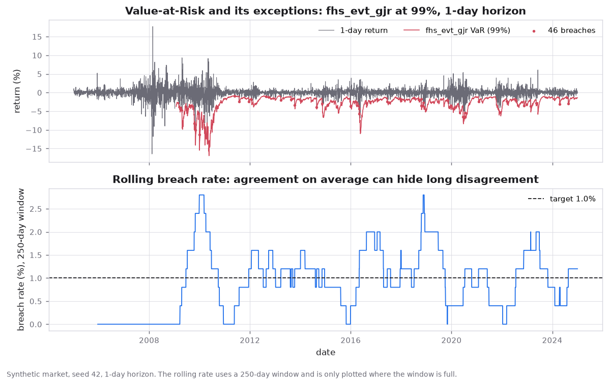

*Breach counts against the nominal level, per route. The line is where a well-calibrated model sits.*

### 5. Invariants that are asserted, not hoped for

Every claim below is enforced by a test that fails if the property is lost:

- **No look-ahead.** Features are strictly lagged, the design matrix is built from shifted columns, and a test corrupts the *future* and asserts an unchanged past forecast. This is the failure that silently inflates every out-of-sample number in a study, so it is checked twice: once on the feature frame, once on the fitted model.
- **The speed flag costs accuracy, never a deliverable.** `--fast` reduces the Monte-Carlo path count and the network's epochs; it does not drop a model or a method. An earlier version did, and the horizon-scaling section silently emptied because the only method that can produce a multi-day number was the one that had been removed.
- **Complex models must earn their place.** A test asserts that the winner is not the naive baseline, and reports the naive baseline's own score so that the comparison cannot be quietly dropped.
- **Every sign convention is pinned by a test.** Three real defects were found this way, each of which produced a plausible-looking number rather than an exception: an off-by-one that made a down day irrelevant to tomorrow's risk, a scoring rule using the coverage level where the tail probability belonged (which reversed a ranking while still producing a winner), and a tail-fit fallback that returned its quantile with the wrong sign, so the caller's clamp turned it into a VaR of exactly zero. The tests that guard these state the wrong answer as well as the right one, so a future regression is recognised rather than merely rejected.

The generator itself is verified against the properties it is supposed to have: the crisis multiplier ramps rather than steps, the intraday bridge sums to the daily move, the jump test recovers the jumps the simulator placed, and the cross-asset correlation structure is preserved.

## Results

These tables are rendered from `outputs/metrics.json` by `scripts/build_docs.py`. The CSVs behind them are in `outputs/tables/`.

### Forecast accuracy

QLIKE is the correct loss for a variance forecast and the one used for ranking: it is the logarithmic score of a Gaussian, so it penalises under-prediction of variance far more than over-prediction, which is the asymmetry a risk number actually has. MSE is reported beside it because a risk committee recognises it.

| model | QLIKE | MSE (bp) | MZ slope | R² (log) | mean forecast vol (annual) |
|---|---|---|---|---|---|
| `harx` | **0.1251** | 587.6 | 1.0089 | 0.9212 | 19.29% |
| `gbm` | 0.1266 | 583.7 | 0.9978 | 0.9245 | 19.34% |
| `har` | 0.1352 | 702.8 | 0.9888 | 0.9050 | 19.63% |
| `gru` | 0.1398 | 721.5 | 1.0004 | 0.9079 | 18.84% |
| `egarch` | 0.1558 | 790.4 | 1.0075 | 0.8789 | 20.23% |
| `gjr` | 0.1677 | 791.0 | 1.0336 | 0.8574 | 19.43% |
| `garch` | 0.1709 | 823.9 | 1.0322 | 0.8524 | 19.33% |
| `ewma_fitted` | 0.2078 | 857.8 | 0.9307 | 0.8477 | 19.17% |
| `ewma_94` | 0.2087 | 973.4 | 0.9467 | 0.8291 | 19.25% |
| `rolling_21` | 0.2461 | 1,117 | 0.8818 | 0.8104 | 19.19% |
| `rolling_63` | 0.2922 | 1,896 | 0.8858 | 0.6997 | 19.43% |

`harx` wins, and the ordering from there is a clean statement about what pays: realised measures and a flexible mean beat leverage, leverage beats a plain recursion, and the trailing-window baselines come last. The spread is easier to read as a relative number than as a rank: `harx` is **49.2%** better on QLIKE than the 21-day baseline, which is the number to quote, not the position.

The Mincer-Zarnowitz slope is the calibration column: 1.0 means the forecast is correctly scaled, below 1.0 means it is too timid. `harx` sits at **1.0089** and `rolling_21` at **0.8818**, so the ranking on QLIKE is not an artefact of scale - the baseline genuinely under-responds. Note also that the joint calibration test rejects almost everything (`p < 0.0001` for the winner): with over four thousand observations, the test has the power to detect deviations far too small to matter, and the coefficient is the informative output, not the pass/fail flag.

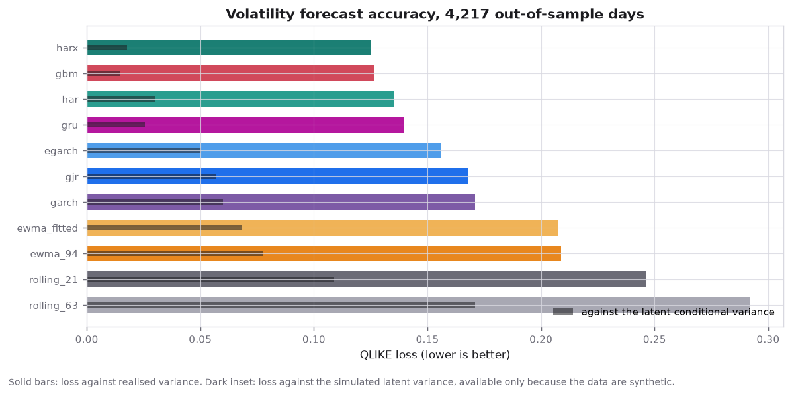

*QLIKE by model with the paired Diebold-Mariano verdicts; a gap that is not significant is not a gap.*

### Where the accuracy comes from

An aggregate score over twenty years is mostly an average over quiet days. The same loss, split by regime, is the more useful table: a model can be excellent in the calm sample and useless in the crises and still place well overall.

| model | GFC 2008-09 | COVID 2020 | 2022 rate shock | calm (all other days) |
|---|---|---|---|---|
| `rolling_21` | 0.2021 | 0.2650 | 0.1764 | 0.2517 |
| `rolling_63` | 0.2046 | 0.2161 | 0.2359 | 0.3015 |
| `ewma_94` | 0.0932 | 0.1826 | 0.1411 | 0.2186 |
| `ewma_fitted` | 0.1371 | 0.1947 | 0.1448 | 0.2150 |
| `garch` | 0.1515 | 0.2171 | 0.1302 | 0.1730 |
| `gjr` | 0.1596 | 0.1976 | 0.1288 | 0.1695 |
| `egarch` | 0.0739 | 0.1235 | 0.0925 | 0.1641 |
| `har` | 0.0327 | 0.0822 | 0.0786 | 0.1446 |
| `harx` | 0.0276 | 0.0740 | 0.0783 | 0.1336 |
| `gbm` | 0.0357 | 0.0741 | 0.0694 | 0.1354 |
| `gru` | 0.0799 | 0.0644 | 0.0881 | 0.1475 |

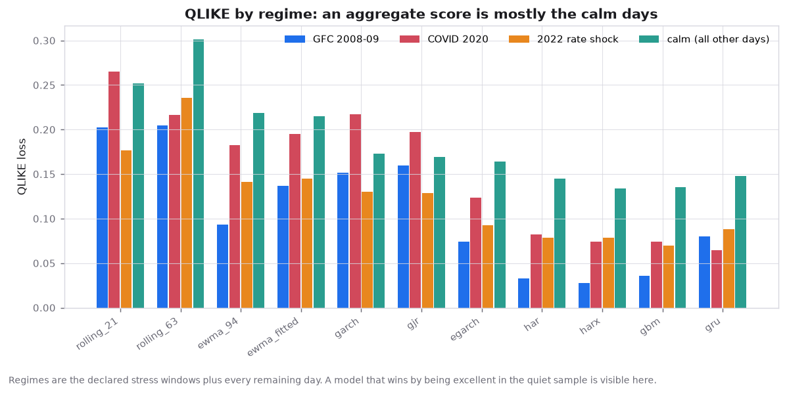

*The same loss by regime. The purpose of the split is that a model which is excellent in the calm sample and useless in the crises cannot hide inside the aggregate.*

### Coverage at 99%, one day

Sorted from fewest breaches to most. The breach rate is the headline; the p-value is the verdict; the Basel zone is the same number through the regulator's lens.

| route | breaches | expected | observed rate | Kupiec p | ind. p | cond. cov. p | DQ p | Basel zone |
|---|---|---|---|---|---|---|---|---|
| `fhs_evt_gjr` | 46 | 41.6 | 1.107% | 0.4972 | 0.3102 | 0.4746 | 0.6698 | green |
| `parametric_t_gjr` | 51 | 41.6 | 1.227% | 0.1557 | 0.2603 | 0.1937 | 0.2497 | green |
| `monte_carlo` | 53 | 41.6 | 1.275% | 0.0875 | 0.2419 | 0.1171 | 0.1950 | green |
| `fhs_gjr` | 59 | 41.6 | 1.419% | 0.0106 | 0.1924 | 0.0163 | 0.0374 | yellow |
| `hs_brw` | 60 | 41.6 | 1.443% | 0.0071 | 0.8867 | 0.0263 | < 0.0001 | green |
| `hs_250` | 69 | 41.6 | 1.660% | < 0.0001 | 0.1407 | 0.00016 | < 0.0001 | green |
| `parametric_normal_gjr` | 72 | 41.6 | 1.732% | < 0.0001 | 0.1111 | < 0.0001 | 0.00015 | green |

Every row has the same expected count (41.6) because the level and horizon are fixed; it is repeated rather than stated once above the table so that no row has to be read against the header to be interpreted.

**3 of 7** routes pass Kupiec. The failures are informative, and so is the direction they fail in. All 4 of them fail the same way. `parametric_normal_gjr` breaches **72** times against roughly 42 expected - the Gaussian tail is too thin for a market with jumps, and no amount of correct conditional volatility repairs a wrong tail shape. The others are milder versions of the same error, and none of them is rejected for being *too cautious*. That is worth stating plainly, because the intuition that an over-conservative risk number is a safe one is not supported by this sample: the panel's problem is understated risk, and correcting it is the work.

The independence and dynamic-quantile columns ask a different question from the rate, and the useful case is a route that passes one and fails the other: a model whose breaches arrive together has the right average and still cannot be relied on, because it is wrong in runs. Here no route passes on the rate and fails on clustering, so the test does not separate anything this run did not already reject. The most structured breach pattern belongs to `parametric_normal_gjr` (p < 0.0001), which Kupiec rejects as well - so the two failures point the same way rather than giving opposite verdicts.

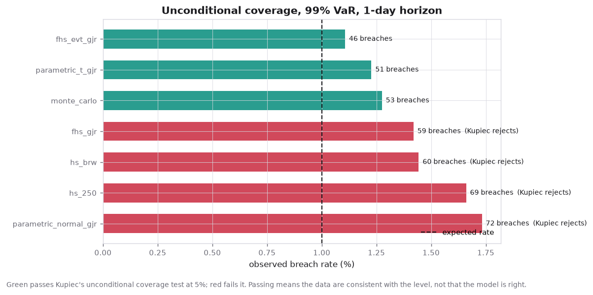

*Breach rate against the nominal level across every route and both horizons.*

### The Basel traffic light

The regulator's test, at the level the regulation is written for. The zone is not a label: five exceptions in 250 days costs 40% more capital than four, and ten doubles it. The multiplier is not linear in the count and the table below is the reason the traffic light is computed in SQL as well as in Python - the number on a dashboard has to come from the same rows the backtest wrote.

| route | exceptions in 250 days | zone | capital add-on |
|---|---|---|---|
| `fhs_evt_gjr` | 3 | green | 0.00% |
| `monte_carlo` | 3 | green | 0.00% |
| `parametric_normal_gjr` | 3 | green | 0.00% |
| `parametric_t_gjr` | 3 | green | 0.00% |
| `hs_250` | 4 | green | 0.00% |
| `hs_brw` | 4 | green | 0.00% |
| `fhs_gjr` | 5 | yellow | 40.00% |

On the final window **6 of 7** routes are green. That is the number a single dashboard shows, and it is misleading: across *all* rolling windows, **14.3%** are outside green and the worst window contains **7** exceptions for the reference route. The difference between the two numbers is the difference between a model that is fine today and a model that is fine on average.

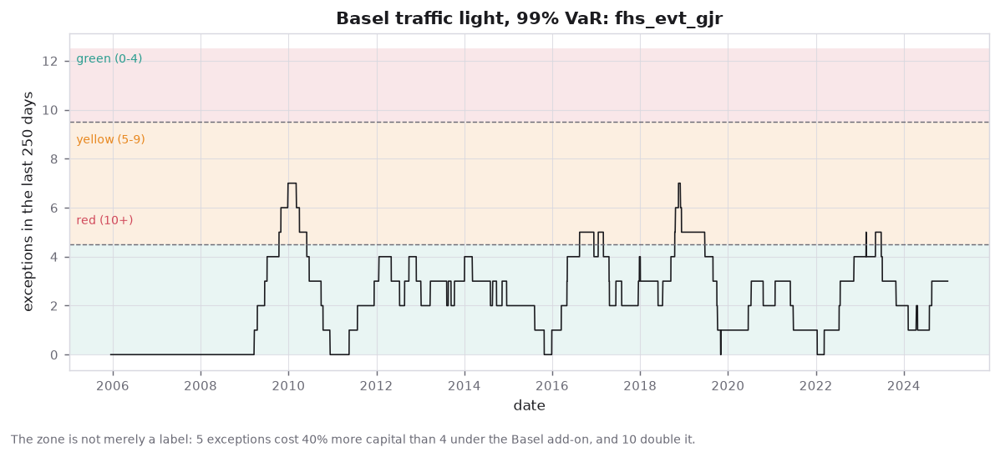

*Rolling 250-day exception counts against the green/yellow/red boundaries.*

### Expected Shortfall: what the test can resolve

Expected Shortfall is only backtestable jointly with VaR, because it is defined on the days VaR was breached. The Acerbi-Szekely statistic is the average, over breach days, of `-r / ES - 1`, standardised: zero when the ES is the right size for the tail it claims to describe. Its standard error is `1/sqrt(n*alpha)` in the number of breach days, which is the number to keep in view when reading the verdicts below.

| route | breach days | mean ES (bp) | mean excess (bp) | Z1 | p | ES adequate |
|---|---|---|---|---|---|---|
| `monte_carlo` | 53 | 347.8 | -8.4 | 0.033 | 0.9741 | yes |
| `parametric_t_gjr` | 51 | 348.2 | -2.6 | 0.038 | 0.9698 | yes |
| `fhs_gjr` | 59 | 343.8 | 9.7 | 0.061 | 0.9511 | yes |
| `fhs_evt_gjr` | 46 | 352.8 | 35.3 | 0.108 | 0.9140 | yes |
| `hs_250` | 87 | 414.9 | 36.9 | 0.123 | 0.9021 | yes |
| `hs_brw` | 71 | 411.3 | 54.4 | 0.153 | 0.8787 | yes |
| `parametric_normal_gjr` | 72 | 269.4 | 48.1 | 0.200 | 0.8415 | yes |

**7 of 7** routes are adequate at this level and horizon. That reads as a clean sheet, and it is worth being precise about what it means. Between 46 and 87 breach days per route at a 99% level give the statistic a standard error of about 1.26, so it rejects only when the average breach exceeds the ES by a factor of about 3.5. Nothing here is wrong by that much; that is not the same as nothing being wrong, and with a band that wide the verdict is closer to "not proven" than to "adequate".

`mean_excess_bp` is the column to read alongside the verdict, and it is positive for **5 of 7** routes: on the days those routes were breached, the loss went past the ES more often than short of it. The sign is the direction of the error and the magnitude is its size, neither of which the p-value carries - and with only 46 to 87 breach days per route, the p-value is the less informative of the two.

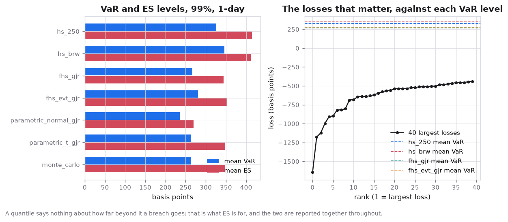

*ES against VaR by route. The gap between the two lines is the quantity the ES test is interrogating.*

### Multi-day scaling

The square-root-of-time rule is exact for independent returns and wrong for everything else. Simulating the fitted recursion gives the true ten-day quantile, so the rule can be measured rather than assumed.

For **fhs_evt_gjr**, the simulated ten-day VaR differs from the scaled one-day VaR by a mean of **3.02%**, and the scaling rule *understates* the risk on **77.8%** of days.

Both signs appear and both are interpretable. A negative gap is the aftermath of a shock: volatility is high and mean-reverting, so scaling by the square root of time is too cautious. A positive gap is a quiet period, where the rule assumes volatility stays where it is and it does not. That asymmetry is why the rule is a statement about the regime as much as about the horizon, and why the share of days it understates - not the mean deviation - is the number to hold on to. A rule that is unbiased on average and wrong 78% of the time in one direction is not a rule anyone would sign off on if it were presented this way.

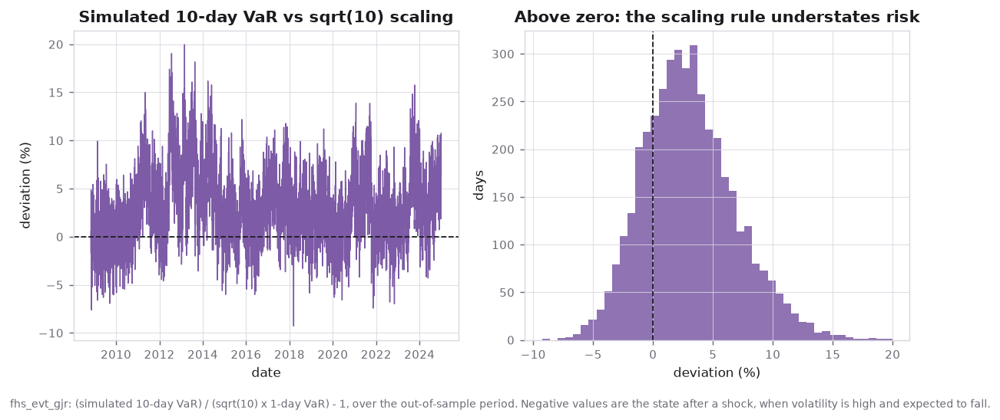

*The deviation of the simulated multi-day quantile from the square-root-of-time rule.*

### Stress windows

The same breach rate, split by regime. These windows are part of the simulation, so unlike a historical study their volatility is known and the breach rate can be attributed to the model rather than to the episode.

| window | days | breaches | breach rate | expected | realised vol (annual) | worst day |
|---|---|---|---|---|---|---|
| GFC 2008-09 | 112 | 3 | 2.679% | 1.0% | 0.3775 | -0.0538 |
| COVID 2020 | 95 | 1 | 1.053% | 1.0% | 0.3227 | -0.0644 |
| 2022 rate shock | 216 | 3 | 1.389% | 1.0% | 0.1573 | -0.0259 |

The failure is concentrated: **GFC 2008-09** breaches 3 times in 112 days against 1.1 expected - a rate of **2.68%** against a nominal 1.0%, or 2.68x. **COVID 2020** has comparable realised volatility (32.27% against 37.75%) and is covered at 1.05x the nominal rate. The difference is not the size of the shock; it is how quickly the filter adapted to it - which is the diagnosis a single aggregate rate can never deliver.

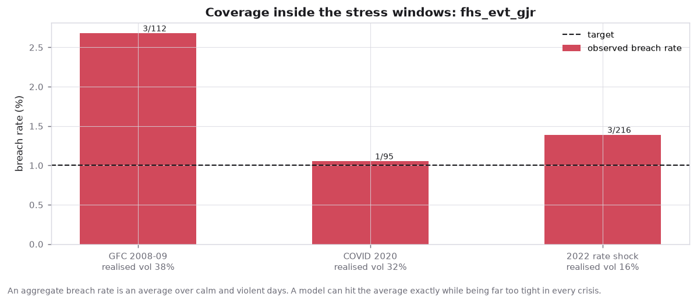

*Breach rates inside the stress windows against the full sample.*

## What this shows

Four conclusions, in decreasing order of how much they surprised me:

1. **The route from a variance forecast to a quantile matters more than the variance forecast does.** Every route here consumes the *same* GJR-GARCH-t filter. At 99% and one day the resulting VaR numbers span from 235 bp to 346 bp - a factor of 1.47 - and 4 of the 7 fail coverage. The model choice is a second-order decision next to the method choice, and most of the industry conversation is about the first.
2. **Risk is understated everywhere, and never overstated.** Every rejection in the study - 4 of 7 routes at the primary level and horizon, and every rejection at every other combination - is a route that breaches *more* often than its level allows. Not one is rejected for being too cautious. The intuition that an over-conservative risk number is the safe choice is not supported here; the error is one-directional, and it is the direction that costs money.
3. **At 99% and 10 days the entire panel fails - 7 of 7 routes.** That is not a model-versus-model result, it is a statement about the horizon: risk measured over 10 days is larger than any of these routes claims, and no amount of care in choosing between them changes it. Because the 10-day returns are computed over overlapping windows, the independence and dynamic-quantile p-values at that horizon are biased downwards and only the breach rate should be read at face value - which is, conveniently, the one that shows the understatement.
4. **Scaling a one-day number by the square root of time is a modelling assumption, not arithmetic.** It understates the simulated risk on **77.8%** of days, in a systematic direction tied to the volatility regime - the same direction as the coverage failures, measured a completely different way.

## Limitations

- **The market is simulated.** The findings about *methods* transfer directly, because the methods do not know where the data came from; the specific numbers do not. The real-data mode exists to check the machinery against a real feed, not to make the results comparable.
- **One asset, one filter.** The panel has four correlated assets but the study is single-asset, and every VaR route reads the GJR-GARCH-t filter. A comparison across filters would be a different and larger study; holding the filter fixed is what makes the method comparison interpretable.
- **Overlapping windows at ten days.** Independence tests at the ten-day horizon are biased downwards and are reported as indicative. Fixing this properly means non-overlapping windows, which would cost four fifths of the sample.
- **The Expected-Shortfall test has low power at this sample size.** A handful of dozen breach days per route cannot resolve a tail that is wrong by a factor of two, so the verdicts above are weak evidence in both directions - passing is not a clean bill of health, and the mean-excess column carries the information the p-value cannot. Twenty-eight tests across the level and horizon grid make this worse rather than better: uncorrected, they invite the one that lands under 5% to be read as a finding.
- **The GARCH likelihood assumes a symmetric Student-t** while the generated data are skewed. That is deliberate - it is the same misspecification real data imposes - but it means the parametric routes are handicapped relative to the empirical ones, and that handicap is a design choice, not a discovery.

## Repository layout

```
src/marketrisk/
  generator.py    the simulated market: components, crises, jumps, intraday bridge
  data.py         loading, caching and the asset panel
  features.py     realised measures, HAR components, the lagged design matrix
  volmodels.py    the eleven models and the walk-forward scheme
  nn.py           the GRU, forward and backward pass written out
  var.py          the seven VaR/ES routes in one suite
  losses.py       QLIKE, MSE, and the tick loss for a quantile
  backtest.py     Kupiec, Christoffersen, DQ, Basel zones, stress slices
  evaluate.py     scoring tables, Diebold-Mariano, Mincer-Zarnowitz, ES tests
  plots.py        every figure
  report.py       the pipeline and RESULTS.md
  api.py          the fitted engine behind FastAPI
  config.py       every constant, in one place
scripts/
  run_pipeline.py run the study
  serve.py        serve the fitted engine
  build_docs.py   render this file and MODEL_DOCUMENTATION.md from metrics.json
sql/              the feature panel, the rolling exception count and the traffic light
tests/            the full suite, including the invariants above
outputs/          figures, tables, metrics.json, RESULTS.md - all committed
```

## Reproducing

```bash
python -m pip install -r requirements.txt
python scripts/run_pipeline.py                  # the full run
python scripts/run_pipeline.py --fast           # same deliverables, smaller budget
python scripts/build_docs.py                    # regenerate these documents
python -m pytest                                # the suite, including the slow end-to-end run
python scripts/serve.py                         # the fitted engine over HTTP
```

The run is seeded and deterministic: the same seed reproduces the same sample, the same fits and the same tables, and `outputs/generator_manifest.json` records the parameters that produced it. `--fast` changes the budget - fewer Monte-Carlo paths, fewer network epochs - and nothing else; the deliverable list is identical, which is asserted by a test.

## The SQL layer

`sql/` holds the three queries that would live in a warehouse: the feature panel with its strictly-lagged log return and 21-day trailing variance, the rolling 250-day exception count, and the Basel zone with its non-linear capital multiplier. They are executed by the test suite on seeded rows and compared **against the Python implementations**, feature by feature, because the classic reason a model works in a notebook and not in production is a lag applied the wrong way or an off-by-one in a rolling window - and that costs nothing to check.

## The service

`scripts/serve.py` exposes the fitted engine over HTTP. The engine holds *history*, not just parameters: when a request supplies fresh closes they are appended to the stored history before the conditional volatility is filtered forward, so the service answers "given what just happened, what is my risk now" rather than "what did my model say when it was last fitted". The distinction is the whole point of a filter, and it is the reason a POST with a large down move returns a visibly higher number than the same request with a quiet day.

## References

- Kupiec (1995), *Techniques for verifying the accuracy of risk measurement models* - the proportion-of-failures test.
- Christoffersen (1998), *Evaluating interval forecasts* - conditional coverage and the independence test.
- Engle & Manganelli (2004), *CAViaR* - the dynamic-quantile test used here as a specification check.
- Acerbi & Szekely (2014), *Backtesting expected shortfall* - the Z1 statistic and its conditions of validity.
- Basel Committee (1996, and BCBS 2019 for FRTB), *Supervisory framework for the use of backtesting* - the traffic light and its capital multipliers.
- Barndorff-Nielsen & Shephard (2004, 2006), *Power and bipower variation* - the jump-robust realised measure.
- Huang & Tauchen (2005), *The relative contribution of jumps to total price variance* - the ratio statistic.
- Boudoukh, Richardson & Whitelaw (1998) - age-weighted historical simulation.
- McNeil & Frey (2000), *Estimation of tail-related risk measures for heteroscedastic financial time series* - filtered historical simulation.
- Patton (2011), *Volatility forecast comparison using imperfect volatility proxies* - why QLIKE and MSE, and why not the others.
- Corsi (2009), *A simple approximate long-memory model of realized volatility* - the HAR family.
- Cho & Elman (2020) - the volatility-latent-noise argument behind scoring against the hidden variance.

